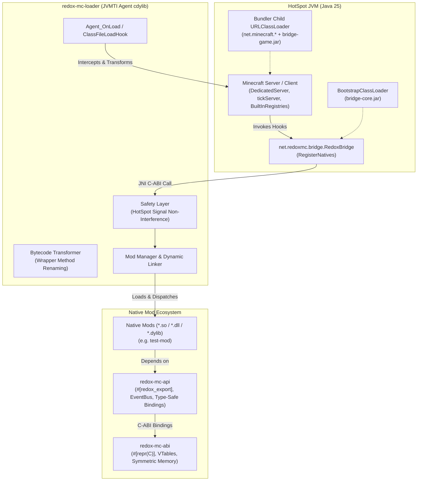

# Redox-MC

A high-performance, native Rust mod loader for Minecraft Java Edition.

Redox-MC enables developers to write Minecraft mods in 100% native Rust, compiled directly to native shared libraries (`.so`, `.dll`, `.dylib`) rather than JVM bytecode (`.jar`). The mod loader attaches to the JVM via a high-performance **JVMTI (JVM Tool Interface)** agent and orchestrates mod loading, bytecode transformation, registry hooks, and strongly-typed events with zero Java overhead.

---

## Architecture Overview



### Key Architectural Pillars

1. **JVMTI Agent & ClassLoader Tiering ([ADR-0001](docs/decisions/0001-jvmti-agent-and-classloader-tiering.md)):** Attaches to the JVM at initialization via `-agentpath`. Uses a 3-tier bridge (`bridge-core`, `bridge-game`, `bridge-client`) to cleanly bypass the Mojang Bundler classloader isolation without deadlock.
2. **Bytecode Wrapper Hooks ([ADR-0002](docs/decisions/0002-bytecode-wrapper-hook-technique.md)):** Renames target methods to `<name>$original` and synthesizes single-basic-block wrapper methods. Eliminates `VerifyError` on Java 25 by bypassing the need for complex `StackMapTable` recalculation.
3. **C-ABI Layout & Symmetric Memory Ownership ([ADR-0003](docs/decisions/0003-c-abi-layout-and-symmetric-memory-ownership.md)):** Stable `#[repr(C)]` layouts, 64-bit alignment padding, and strict symmetric deallocation boundaries (`redox_loader_free_*` / `redox_mod_free_*`) to prevent allocator mismatch across dynamic libraries.
4. **Panic Isolation & Signal Safety ([ADR-0004](docs/decisions/0004-panic-isolation-boundary.md)):** Procedural macro `#[redox_export]` catches mod panics via `catch_unwind(AssertUnwindSafe)`. Zero custom OS signal handlers registered, preserving HotSpot's implicit null checks and deoptimization.
5. **Strongly-Typed Event Bus ([ADR-0005](docs/decisions/0005-typed-event-bus-architecture.md)):** High-throughput, thread-safe pub/sub event bus supporting cancellation and deterministic priorities (`Highest -> Normal -> Lowest`).

---

## Workspace Crates

| Crate | Purpose |
|---|---|
| [`redox-mc-abi`](redox-mc-abi) | Stable `#[repr(C)]` FFI structs, vtables, error codes, and symmetric memory management contracts. |
| [`redox-mc-api`](redox-mc-api) | High-level native mod development SDK, strongly-typed pub/sub event bus, and registration traits. |
| [`redox-mc-api-macros`](redox-mc-api-macros) | Procedural macro (`#[redox_export]`) providing FFI panic containment and ABI fallback conversion. |
| [`redox-mc-bindgen`](redox-mc-bindgen) | Offline Java classfile parser and typed JNI binding generator with `AtomicPtr` method/field ID caching. |
| [`redox-mc-adapter-api`](redox-mc-adapter-api) | Abstract trait interfaces decoupling version-specific bytecode hooks from the core loader. |
| [`redox-mc-adapter-26-3`](redox-mc-adapter-26-3) | Concrete hook definitions and bytecode validation for Minecraft 26.3. |
| [`redox-mc-bridge`](redox-mc-bridge) | Three-tier Java bridge (`bridge-core`, `bridge-game`, `bridge-client`) facilitating Java-to-Rust communication. |
| [`redox-mc-loader`](redox-mc-loader) | Core JVMTI agent, bytecode transformer, dynamic mod loader, and runtime safety layer. |
| [`examples/test-mod`](examples/test-mod) | Reference native mod demonstrating lifecycle hooks, registry interaction, and event handling. |

---

## Project Status

- [x] **Phase 1: Foundation and Vertical Slice**
  - JVMTI agent in native Rust (`redox-mc-loader`).
  - Three-tier Java bridge architecture (`bridge-core`, `bridge-game`, `bridge-client`).
  - Mojang Bundler child `URLClassLoader` capture and deadlock-free `DefineClass`.
  - Decoupled version adapter architecture (`redox-mc-adapter-api`, `redox-mc-adapter-26-3`).
- [x] **Phase 2: FFI ABI, Safety Layer & Tooling**
  - Stable `#[repr(C)]` C-ABI, vtables, and symmetric allocator memory ownership (`redox-mc-abi`).
  - Offline classfile parser and typed JNI binding generator with `AtomicPtr` cache (`redox-mc-bindgen`).
  - Panic containment boundary (`#[redox_export]` in `redox-mc-api-macros`).
  - HotSpot signal non-interference verification (`redox-mc-loader/src/safety.rs`).
  - Cross-platform CI/CD matrix (Linux x86_64, Windows x86_64, ARM64).
  - Microbenchmark suite comparing raw JNI, cached JNI, and FFI callback latencies.
- [ ] **Phase 3: Deep Game Integration & Event System** *(In Progress)*
  - [x] **Task 3.1:** Registry freeze wrapper hook (`BuiltInRegistries.freeze`) with pre/post hooks and JNI inspection.
  - [x] **Task 3.2:** Strongly-typed pub/sub event bus with cancellation and priority ordering (`redox-mc-api`).
  - [ ] **Task 3.3:** Mod discovery, manifest parsing, and dependency topological resolution.
  - [ ] **Task 3.4:** Comprehensive end-to-end integration test suite with sample mods.

---

## Quick Start & Building

### Prerequisites

- **Rust:** Stable toolchain (`cargo`, `rustc` 1.85+ recommended).
- **Java:** JDK 25 (`javac`, `jar`, `javap`).
- **OS:** Linux (x86_64, aarch64), Windows (x86_64), or macOS (aarch64).

### Building

```bash
# 1. Compile Java bridge modules
./redox-mc-bridge/build.sh

# 2. Build the complete Rust workspace
cargo build --workspace --all-targets

# 3. Run all unit and integration tests (46+ tests across workspace)
cargo test --workspace

# 4. Check formatting and linter
cargo fmt --all -- --check
cargo clippy --workspace --all-targets -- -D warnings
```

### Running with Minecraft Server

To attach the JVMTI agent to a vanilla Minecraft server:

```bash
# Set up bridge path
export REDOX_BRIDGE_CORE_JAR="$(pwd)/redox-mc-bridge/build/bridge-core.jar"

# Launch server with agent attached
java -agentpath:target/debug/libredox_mc_loader.so \
     -jar server.jar nogui
```

*(On Windows, replace `.so` with `.dll`; on macOS, replace with `.dylib`)*.

---

## Architecture Decision Records (ADRs)

Key architectural choices are formally documented in [`docs/decisions/`](docs/decisions/):

- [ADR-0001: JVMTI Agent and Three-Tier ClassLoader Bridge Architecture](docs/decisions/0001-jvmti-agent-and-classloader-tiering.md)
- [ADR-0002: Bytecode Wrapper Method Renaming for Clean HotSpot Verification](docs/decisions/0002-bytecode-wrapper-hook-technique.md)
- [ADR-0003: Stable C-ABI Layout and Symmetric Memory Ownership Across Dynamic Libraries](docs/decisions/0003-c-abi-layout-and-symmetric-memory-ownership.md)
- [ADR-0004: In-Mod Panic Isolation Boundary and HotSpot Signal Non-Interference](docs/decisions/0004-panic-isolation-boundary.md)
- [ADR-0005: Strongly-Typed Pub/Sub Event Bus with Deterministic Priorities](docs/decisions/0005-typed-event-bus-architecture.md)

---

## Developer Guides & Policies

- **[CONTRIBUTING.md](CONTRIBUTING.md):** Guidelines for code contributions, TDD workflow, commit messages, and PR checklists.
- **[SECURITY.md](SECURITY.md):** Security policies, memory boundary guarantees, HotSpot VM signal safety, and reporting vulnerabilities.
- **[AGENTS.md](AGENTS.md):** Architecture boundaries, strict invariants, JNI/HotSpot pitfalls, and constraints for AI coding agents.

---

## Legal Disclaimer

This is an unofficial, community-driven open source project not affiliated with, endorsed by, or associated with Mojang Studios or Microsoft Corporation. This repository contains and distributes **no proprietary Minecraft code, assets, or binaries**. Users must supply their own legally acquired copy of Minecraft to run and test mods.

---

## License

Licensed under either of:

- Apache License, Version 2.0 ([LICENSE-APACHE](LICENSE-APACHE) or http://www.apache.org/licenses/LICENSE-2.0)
- MIT license ([LICENSE-MIT](LICENSE-MIT) or http://opensource.org/licenses/MIT)

at your option.
