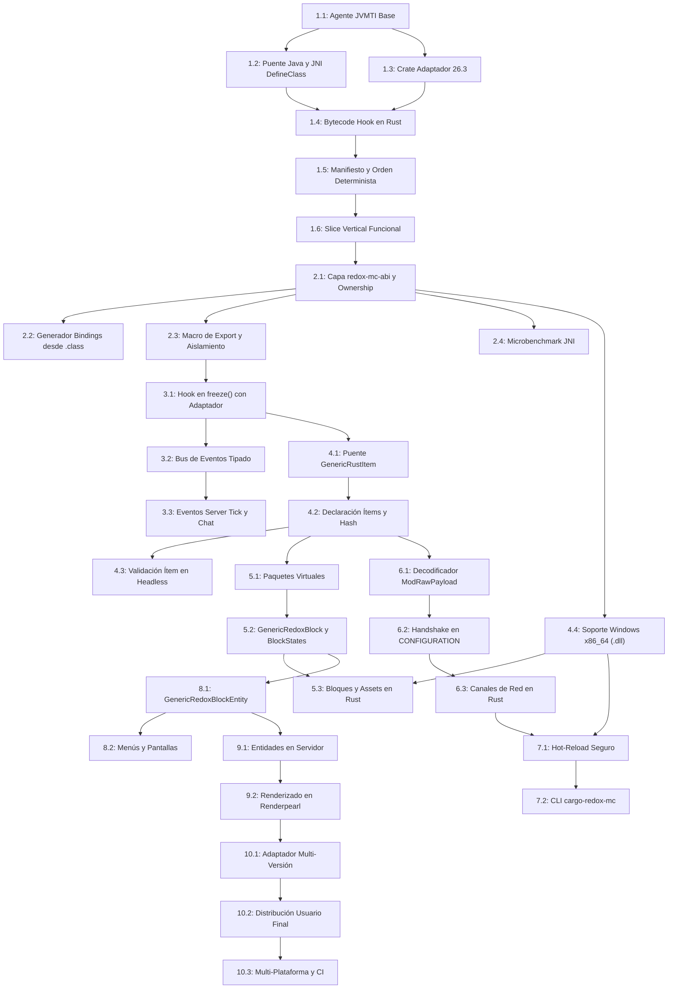

# Plan de Implementación: Modloader Nativo en Rust para Minecraft Java Edition 26.3

## 0. Cambios respecto a la versión anterior

A continuación se detalla el estado de cada punto de revisión solicitado:

1. **Visibilidad de clases del puente Java y classloader del bundler**: **Aplicado**. Se verificó con `javap -c -p` que `net.minecraft.bundler.Main` hace `this.getClass().getClassLoader().getParent()` pasando `PlatformClassLoader` como padre del `URLClassLoader` del juego, haciendo que `AppClassLoader` y el loader del juego sean hermanos. El mecanismo definido consiste en: guardar el `jobject loader` recibido en `ClassFileLoadHook` para `net.minecraft.core.registries.BuiltInRegistries` y, fuera del hook (durante la primera invocación del puente), ejecutar JNI `DefineClass` sobre ese classloader para definir las clases de `redox-mc-bridge-game` (superclases primero). Se eliminó por completo la detección por `Main`.
2. **Verificación con `javap -c -p` del classloader padre del bundler**: **Aplicado**. Anotado en la sección 2.1 con el desglose exacto de las instrucciones de bytecode ejecutadas por el bundler.
3. **Crate `redox-mc-adapter-26-3` en Fase 1**: **Aplicado**. Se adelantó la creación de `redox-mc-adapter-26-3` a la Fase 1 (Tarea 1.3) con la tabla canónica de hooks (clase, método, firma/descriptor). Las tareas de transformación de bytecode (1.4 y 3.1) consumen esta tabla en lugar de hardcodear nombres.
4. **Compilación Windows x86_64 antes de Tarea 5.3**: **Aplicado**. Se ubicó el soporte de compilación cruzada para Windows x86_64 (`.dll`) en la Fase 4 (Tarea 4.4), quedando listo antes de abordar los bloques y assets (Tarea 5.3) y el hot-reloading (Fase 7).
5. **Reclasificación de esfuerzos y rango de días por tarea**: **Aplicado**. Tareas 1.2, 5.2 y 8.2 reclasificadas a **Large (L)**; Tarea 9.2 reclasificada a **Extra Large (XL)**. Se añadió una estimación en rango de días a todas las tareas del plan.

---

## 1. Resumen Ejecutivo

Este documento define el plan integral de diseño, arquitectura y descomposición de tareas para construir un **modloader modular en Rust** para Minecraft Java Edition versión **26.3** (Protocolo 777, Java 25, classfile version 69.0). El modloader opera mediante un agente **JVMTI** nativo en Rust, inyectado al arranque de la JVM, que realiza transformación de bytecode en memoria mediante Rust, conecta un puente Java dividido (`redox-mc-bridge-core`, `redox-mc-bridge-game`, `redox-mc-bridge-client`) con el motor de mods nativos (`redox-mc-loader`), y expone una API declarativa y segura en Rust (`redox-mc-api`) para compilar mods como bibliotecas dinámicas nativas (`.so`, `.dll`, `.dylib`).

---

## 2. Descubrimientos Clave en el Código Decompilado (MC 26.3)

### 2.1. El Problema del Bundler y Verificación Bytecode del ClassLoader Padre
- **Verificación en el Bytecode (`javap -c -p`)**:
  Al desensamblar `net.minecraft.bundler.Main` en `/home/ender/server.jar`, el método `run([Ljava/lang/String;)V` ejecuta:
  ```bytecode
  104: aload_0                           // this (instancia en AppClassLoader)
  105: invokevirtual #83                 // Method getClass:()Ljava/lang/Class;
  108: invokevirtual #87                 // Method getClassLoader:()Ljava/lang/ClassLoader;  -> AppClassLoader
  111: invokevirtual #93                 // Method getParent:()Ljava/lang/ClassLoader;       -> PlatformClassLoader
  114: astore        7                   // Variable 7 = PlatformClassLoader
  116: new           #98                 // class java/net/URLClassLoader
  ...
  134: aload         7                   // Pasa PlatformClassLoader como argumento parent
  136: invokespecial #110                // Method URLClassLoader."<init>":([Ljava/net/URL;Ljava/lang/ClassLoader;)V
  ```
- **Diagnóstico Confirmado**: `net.minecraft.bundler.Main` asigna explícitamente como padre del `URLClassLoader` a `PlatformClassLoader`. Por tanto, `AppClassLoader` (el System ClassLoader de la JVM) y el `URLClassLoader` del juego son **hermanos** (*siblings*). Ninguna clase colocada en el System ClassLoader puede resolver clases cargadas por el `URLClassLoader` de Minecraft.
- **Mecanismo de Inyección Adoptado**:
  1. `redox-mc-bridge-core` (cero dependencias de Minecraft, contiene `RedoxBridge` y métodos `native`) se añade al bootstrap search mediante `AddToBootstrapClassLoaderSearch`, siendo visible para todos los classloaders de la JVM.
  2. En `ClassFileLoadHook`, cuando el agente intercepta la clase `net/minecraft/core/registries/BuiltInRegistries`, guarda una referencia global JNI al `jobject loader` recibido.
  3. Fuera del hook (al dispararse la primera invocación del puente), el agente utiliza JNI `DefineClass` sobre ese `loader` para definir secuencialmente las clases de `redox-mc-bridge-game` (superclases primero: `GenericRedoxBlock`, `GenericRustItem`, etc.), garantizando resolución limpia de tipos sin depender de hacks en `Main`.
  4. `redox-mc-bridge-client` se reserva únicamente para entornos con cliente gráfico.

### 2.2. Ciclo de Vida de Registros y Hook Canónico
- **Punto de Arranque Común**: Cliente ([`net.minecraft.client.main.Main`](file:///home/ender/rustmc/out-client/net/minecraft/client/main/Main.java#L159)) y servidor ([`net.minecraft.server.Main`](file:///home/ender/rustmc/out-server/net/minecraft/server/Main.java#L107)) llaman a [`Bootstrap.bootStrap()`](file:///home/ender/rustmc/out-client/net/minecraft/server/Bootstrap.java#L43).
- **Secuencia en Registros**:
  ```java
  public static void bootStrap() {
     createContents();
     freeze();
     validate(REGISTRY);
  }
  ```
- **Comprobación de `freeze()`**: `BuiltInRegistries.freeze()` es `private static void freeze()` y se invoca exactamente una vez en toda la ejecución, en la línea 403 de `BuiltInRegistries.bootStrap()`.
- **Ventana Canónica**: Engancharse al **inicio** de `BuiltInRegistries.freeze()` garantiza que todos los bloques, ítems y entidades vanilla ya fueron creados por `createContents()`, pero los registros aún tienen `isFrozen() == false`.

### 2.3. Paridad de Registros y Sincronización en Red
- **Verificación en el Código**: [`RegistryDataLoader.SYNCHRONIZED_REGISTRIES`](file:///home/ender/rustmc/out-server/net/minecraft/resources/RegistryDataLoader.java#L164) en la fase `CONFIGURATION` (`SynchronizeRegistriesTask`) solo transmite registros dinámicos de datapacks (biomas, variantes, encantamientos).
- **Registros Estáticos No Sincronizados**: `BuiltInRegistries.BLOCK`, `ITEM`, `ENTITY_TYPE`, `FLUID` y `BLOCK_ENTITY_TYPE`.
- **Mitigación**:
  1. Carga de mods en **orden determinista** (orden topológico por dependencias de manifiesto + desempate lexicográfico por mod ID).
  2. Generación de un **hash de contenido de registros** verificado en el handshake de red en fase `CONFIGURATION`.

---

## 3. Decisiones de Arquitectura y Estrategias Técnicas

### 3.1. Estabilidad de ABI y Ownership de Memoria
- **C-ABI (`repr(C)`)**: Se define `redox-mc-abi` con vtables y punteros opacos.
- **Ownership Estricto**: La memoria no se asigna en un lado y se libera en el otro. Cada binario libera exclusivamente la memoria que asignó mediante funciones expuestas de la ABI (`redox_loader_free_*` y `redox_mod_free_*`).
- **Aislamiento de Pánicos**: El loader **no** captura pánicos a través de `extern "C"`. Los shims exportados por los mods se generan mediante la macro `#[redox_export]` de `redox-mc-api`, envolviendo el cuerpo en `std::panic::catch_unwind`, registrando el backtrace y retornando `FfiResult::Panic`.

### 3.2. Gestión de Fallos y HotSpot
- **Sin Señales Personalizadas**: No se registran signal handlers para `SIGSEGV` ni Access Violation en el agente nativo, preservando los safepoint polls y comprobaciones de null implícitas de HotSpot. El diagnóstico se basa en los informes `hs_err_pid<pid>.log`.

### 3.3. Rendimiento JNI y Microbenchmarking
- **Diseño Declarativo**: Registros en bloque al inicio; cero llamadas JNI en tiempo de juego para elementos pasivos.
- **Microbenchmarking**: La referencia aproximada de 10-25 ns por llamada JNI se verifica experimentalmente en una tarea dedicada.

### 3.4. Hot-Reloading Seguro en Desarrollo
- **Copia Temporal y Swap Atómico**:
  1. Copia del binario a `mod_cache/mod_<timestamp>.so` / `.dll`.
  2. Carga con `libloading` y swap atómico de callbacks (`ArcSwap`).
  3. **Sin `dlclose`**: Se omite la descarga para evitar UB con destructores de thread-locals de Rust y problemas de bloqueo de archivos en Windows.

### 3.5. Transformación de Bytecode en Rust y Crate Adaptador
- **Crate Adaptador `redox-mc-adapter-26-3`**: Centraliza la tabla de hooks (nombres de clases, métodos y descriptores) desde la Fase 1.
- **Técnica del Método Envoltorio (Wrapper)**:
  - En `ClassFileLoadHook`, se renombra el método original a `<nombre>$original` y se inserta un nuevo método con el nombre y firma original que llama al hook y luego al original.
  - No requiere alterar StackMapTable. Se ejecuta 100% en Rust.

---

## 4. Estructura del Proyecto (Workspace)

```
redox-mc/
├── Cargo.toml                    # Cargo workspace

├── redox-mc-abi/                   # Tipos repr(C), vtables y funciones de deasignación
├── redox-mc-adapter-26-3/          # Metadatos de versión y tabla de hooks de MC 26.3
├── redox-mc-api/                   # API pública para mods y macro #[redox_export]
├── redox-mc-bindgen/               # Generador de bindings leyendo .class de los jars
├── redox-mc-loader/                # Agente JVMTI en Rust + despachador + transformador
├── redox-mc-bridge/                # Raíz del puente Java
│   ├── bridge-core/              # Sin dependencias MC -> AddToBootstrapClassLoaderSearch
│   ├── bridge-game/              # Extiende MC común -> JNI DefineClass en el loader del juego
│   └── bridge-client/            # Extiende MC cliente -> cargado sólo en cliente
├── cargo-redox-mc/                 # CLI de desarrollo: compilar mods, empaquetar, lanzar juego
└── examples/
    └── test-mod/                 # Mod de prueba en Rust
```

---

## 5. Fases de Implementación y Desglose de Tareas



---

## 6. Matriz de Riesgos y Mitigaciones Actualizada

| Riesgo | Impacto | Mitigación |
|---|---|---|
| **Incompatibilidad de ClassLoaders con Bundler** | Crítico | Capturar `loader` en `BuiltInRegistries` en `ClassFileLoadHook` y definir `bridge-game` vía JNI `DefineClass` fuera del hook. |
| **Pánicos de Mods que Crucen FFI** | Crítico | Macro `#[redox_export]` con `catch_unwind` dentro del `cdylib` del mod. Retorno de `FfiResult::Panic`. |
| **Corrupción de Memoria por Asignadores Distintos** | Alto | Regla de deasignación por el asignador de origen con funciones explícitas en `redox-mc-abi`. |
| **Colapso de HotSpot por Manejadores de Señales** | Alto | No instalar signal handlers para `SIGSEGV`/Access Violation. Confiar en `hs_err` de HotSpot. |
| **Desincronización de Paletas de Bloques e Ítems** | Alto | Carga en orden determinista (manifiesto topológico + lexicográfico) y hash de contenido en `CONFIGURATION`. |
| **Crashes en Hot-Reloading** | Medio | Copias temporales del binario, swap atómico y omitir `dlclose` (previniendo UB en thread-locals y locks de Windows). |
| **Recursión en `ClassFileLoadHook`** | Alto | Transformación de bytecode ejecutada 100% en Rust. Sin llamadas intermedias a Java en el hook. |
| **Complejidad de Renderpearl (Vulkan/SPIR-V)** | Alto | Conectar únicamente a través del contrato oficial de `SubmitNodeCollector` y `EntityRenderState`. |

---

## 7. Estrategia de Pruebas Independientes

1. **Test Harness Standalone en Rust Puro**: Pruebas de carga dinámica, orden determinista, bus de eventos y microbenchmarks JNI.
2. **Servidor Headless de Pruebas (`nogui`)**: Pruebas de arranque, registros (`/give`, `/setblock`), persistencia NBT y red sin GPU.
3. **Cliente Gráfico Completo**: Validación de recursos virtuales, texturas, pantallas y renderizado en Renderpearl.
